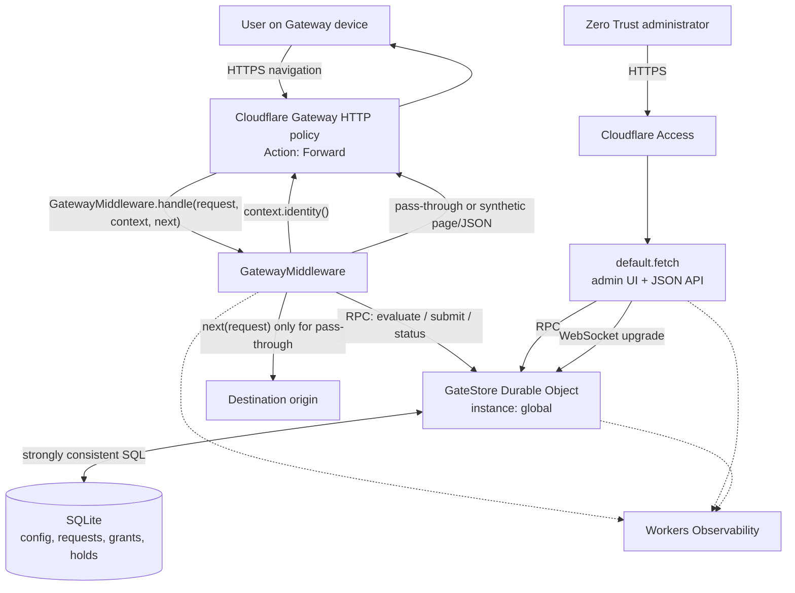

# Product Requirements Document - `purpose-justification-workersgw`

> Status: implemented by CR-001; refined by CR-002 (removed the IP-based limitation copy from the deployed Worker UI), CR-003 (Gateway user identity, Forward action, zero-origin synthetic responses), and CR-004 (admin origin derived from the request; README refresh); manual account activation remains
> Generated: 2026-08-27
> Implemented: 2026-08-28
> Gateway Forward contract: public beta since 2026-10-15 — [Forward traffic](https://developers.cloudflare.com/cloudflare-one/traffic-controls/integrate-workers/forward-traffic/), [Available context](https://developers.cloudflare.com/cloudflare-one/traffic-controls/integrate-workers/available-context/), and the `gateway-workers` agent skill. The action was previously called "Custom Actions".
> Reference implementation: an earlier Gateway coaching-page Worker POC

## 1. Overview

### Problem statement

Cloudflare Gateway can dispatch matched HTTP traffic to a Worker, but it does not provide a human approval workflow that asks why a user needs a site and temporarily releases that site only after an administrator approves the request.

### Proposed solution

Build a Cloudflare Worker that replaces unapproved top-level navigations with a purpose-justification form, stores requests in a strongly consistent SQLite-backed Durable Object, and serves an Access-protected admin console for approving or denying them. Approved Gateway user (email) and host pairs pass through until their grant expires; denied pairs receive a block page for a configurable hold period.

### Target user persona

**Primary - Zero Trust administrator / solutions engineer.** Operates a Cloudflare Gateway deployment or demo, reviews purpose-justification requests, and grants time-limited access without changing Gateway policy.

**Secondary - user on a Gateway-enrolled device.** Encounters a form while navigating to a matched site, submits a justification, waits for a decision, and continues automatically if approved.

### Scope and terminology

- This is a POC built on the Gateway **Forward** action (API value `forward`), which is in public beta and may change.
- "Identity" means the lowercased email returned by the Gateway-provided `await context.identity()`. The Gateway display name (`identity.name`) is stored for admin display only. Sessions without an identified email are blocked with a sign-in page; there is no source-IP fallback. No identity is ever taken from client-supplied headers.
- "Host" means the lowercased request hostname with one leading `www.` removed. Grants apply to this normalized host, not a URL path or all subdomains.
- "Admin hostname" (`<your-custom-domain>` in this document) means the Access-protected custom domain configured in `wrangler.toml`. No source file hardcodes it.
- "GateStore" means the single SQLite-backed Durable Object instance named `global` and bound as `GATE_STORE`.
- The product gates top-level browser navigations only. Non-navigation traffic passes through by explicit POC decision.

## 2. Technical Architecture

### 2.1 System diagram



### 2.2 Entrypoints and trust boundaries

The Worker has three exported platform classes:

| Export | Invocation path | Responsibility | Authentication |
|---|---|---|---|
| `GatewayMiddleware extends WorkerEntrypoint` | Gateway dynamic dispatch | Inline navigation gating and public submit/status protocol | Gateway user identity plus HMAC token bound to email and host |
| default `WorkerEntrypoint` | HTTP requests to the admin hostname | Admin HTML, JSON API, health endpoint, WebSocket proxy | Cloudflare Access on the hostname only |
| `GateStore extends DurableObject` | `GATE_STORE.getByName("global")` | State machine, config, SQL queries, alarms, WebSocket broadcast | In-process binding; not directly public |

The named `GatewayMiddleware` export is required by the Gateway Forward contract and must not be renamed. `context` and `next` are typed with `GatewayMiddlewareContext` and `GatewayMiddlewareNext` from `@cloudflare/zt-types` (type-only imports, re-exported from `src/types.ts` as `GatewayContext` and `NextFn`). HTTP requests cannot invoke its `handle()` method. GateStore uses RPC methods for application operations; its `fetch()` method accepts only the admin WebSocket upgrade forwarded by `default.fetch`.

Cloudflare Access is the only admin authentication boundary. The Worker deliberately does not verify an Access JWT. It records `cf-access-authenticated-user-email` when present for best-effort attribution, but the value is marked as not JWT-verified and becomes `unknown` when absent.

### 2.3 Gateway middleware flow

```text
handle(request, context, next)
 |
 |-- Resolve normalized host and privacy-reduced URL
 |     Invalid host -> fail-closed 503 page
 |
 |-- Auth endpoint? -> next(original request), pass through
 |
 |-- Unknown x-gw-pj-action? -> 400 JSON (no next())
 |
 |-- No action and not a top-level document navigation?
 |     -> next(original request), pass through (no identity lookup)
 |
 |-- STATE_SIGNING_SECRET missing -> fail-closed 503
 |
 |-- await context.identity()
 |     rejects -> fail-closed 503 (reason identity_unavailable)
 |     null / no usable email -> 403 sign-in page or 403 identity_required JSON
 |
 |-- x-gw-pj-action == submit?
 |     Verify form token and body -> GateStore.submit() -> synthetic JSON
 |
 |-- x-gw-pj-action == status?
 |     Verify status token -> GateStore.status() -> synthetic JSON
 |
 |-- GateStore.evaluate(email, host)
 |     granted -> next(original request), pass through
 |     pending -> wait page
 |     denied -> block page
 |     none -> mint form token, form page
 |
 '-- GateStore/config/internal failure -> fail-closed 503 retry page
```

Hard invariants:

1. `next()` is called **at most once**, and only on the three pass-through paths: authentication bypass, non-navigation traffic, and an active grant. Every synthetic response (form, wait, block, sign-in, submit/status JSON, protocol errors, and fail-closed `503`) is returned without calling `next()`, so blocked and protocol traffic never reaches the destination origin. If `next()` throws, propagate the error; never call it a second time.
2. The original request is forwarded unchanged on pass-through paths. No request is ever rewritten for the origin.
3. The justification body is consumed only by the Worker and is never sent to the destination origin, persisted in logs, or included in WebSocket events.
4. Synthetic response bodies are byte-oriented streams created with `IdentityTransformStream`. For `HEAD` requests the synthetic response has headers and no body, as required by the Forward contract.
5. Synthetic responses are built from a controlled header set; origin cookies, redirects, CSP, content metadata, and caching directives cannot leak into them because no origin response exists.
6. If a failure happens after `next()` returned (pass-through tagging), the retained upstream body is cancelled through `waitUntil` and a fresh `503` is returned without a second `next()` call.
7. The middleware never buffers an origin response body.
8. `context.identity()` is awaited only on gated paths (protocol actions and top-level navigations), never for authentication bypass or subresources.

### 2.4 Navigation, identity, host, and URL handling

#### Top-level navigation detection

`isTopLevelDocument(headers)` returns true only when either condition holds:

- `sec-fetch-mode` is `navigate` and `sec-fetch-dest` is `document`.
- Both `sec-fetch-mode` and `sec-fetch-dest` are absent and `accept` contains `text/html`.

It returns false for `curl` defaults (`accept: */*`), XHR/fetch, scripts, styles, images, fonts, workers, iframes, manifests, and any request with a present `sec-fetch-mode` other than `navigate`.

#### Authentication endpoint skip list

The middleware passes through requests whose lowercased pathname starts with one of:

```text
/oauth
/auth
/login
/logout
/callback
/.well-known/
/saml
/sso
/token
/favicon.ico
/robots.txt
```

Prefix matching is intentional. `/oauthlike` matches; `/api/login` does not.

#### Identity resolution

1. Await `context.identity()` from the Gateway Forward context. Never trust a client-visible request header as identity.
2. If the call rejects, fail closed with the `503` page or `503 service_unavailable` JSON and log `identity_unavailable`.
3. If it resolves `null`, or `email` is missing, longer than 254 characters, or not of the form `local@domain` without whitespace, treat the session as anonymous: return `403` with the sign-in required page (navigations) or `403 {"error":"identity_required","message":"A signed-in Zero Trust session is required."}` (protocol actions). Never create a shared identity.
4. Otherwise the identity is `identity_kind = 'email'` with the trimmed, lowercased email.
5. `identity.name` is trimmed, stripped of control characters, capped at 200 code points, and stored as `identity_name` (or `null`). It is display metadata only and never used for authorization.

`context.srcIp`, groups, SAML attributes, OIDC claims, and device posture are not used in v1.

#### Host normalization

- Prefer the hostname parsed from `request.url`; fall back to `gatewayContext.host` only if parsing fails.
- Lowercase it, convert international names to URL-parser punycode form, remove the port and trailing DNS root dot, and remove one leading `www.`.
- Reject an empty host or a host longer than 253 characters with a fail-closed `503` response.
- `www.www.example.com` normalizes to `www.example.com`.
- A grant for `example.com` covers `www.example.com` after normalization but does not cover `app.example.com`.

#### Persisted requested URL

Persist only `origin + pathname`, capped at 2,048 characters. Remove query strings and fragments before persistence and structured logging. If the sanitized value exceeds the cap, retain the origin and truncate only the pathname with a terminal `...`.

### 2.5 Cloudflare services used

| Service | Use | Justification |
|---|---|---|
| Workers | Gateway middleware and admin HTTP surface | Required by the Gateway Forward action and keeps deployment in one script. |
| Durable Objects | One `GateStore` coordination actor | Admin decisions and user polling require immediate, strongly consistent state. |
| SQLite in Durable Objects | Config, request queue, grants, deny holds, audit history | Relational queries, partial indexes, atomic state transitions, and no external database. |
| Durable Object alarms | Expiry and retention cleanup | One alarm schedules the next pending, grant, hold, or retention deadline. Correctness also uses lazy expiry. |
| Durable Object WebSocket Hibernation API | Live admin queue updates | Keeps idle admin sockets connected without keeping the object active. |
| Cloudflare Access | Admin hostname authentication | Cloudflare-native SSO boundary with no application login implementation. |
| Workers Observability | Structured operational logs | Required by repository rules and avoids adding a separate logging service. |
| Custom domain | Admin surface | Uses `custom_domain = true` so Cloudflare manages DNS without a zone ID. |

Explicitly not used: KV, D1, R2, Queues, Workflows, Workers AI, third-party databases, or third-party authentication.

### 2.6 GateStore data model

GateStore is addressed only with `env.GATE_STORE.getByName("global")`. All timestamps are integer Unix milliseconds in SQLite and ISO-8601 UTC strings at API boundaries. IDs are `crypto.randomUUID()` values.

Schema initialization runs in the Durable Object constructor and is limited to idempotent `CREATE TABLE IF NOT EXISTS`, index creation, and inserting the default config when absent. Request handling must not be wrapped in `blockConcurrencyWhile()`.

```sql
CREATE TABLE IF NOT EXISTS schema_meta (
  id INTEGER PRIMARY KEY CHECK (id = 1),
  version INTEGER NOT NULL            -- current: 2
);

CREATE TABLE IF NOT EXISTS app_config (
  id INTEGER PRIMARY KEY CHECK (id = 1),
  document TEXT NOT NULL
);

CREATE TABLE IF NOT EXISTS requests (
  id TEXT PRIMARY KEY,
  submission_nonce TEXT NOT NULL UNIQUE,
  identity_kind TEXT NOT NULL,
  identity TEXT NOT NULL,             -- lowercased Gateway user email
  identity_name TEXT,                 -- added by schema v2; Gateway display name or NULL
  host TEXT NOT NULL,
  requested_url TEXT NOT NULL,
  justification TEXT NOT NULL,
  policy_kind TEXT NOT NULL,
  status TEXT NOT NULL CHECK (status IN ('pending', 'approved', 'denied', 'expired')),
  created_at INTEGER NOT NULL,
  expires_at INTEGER NOT NULL,
  decided_at INTEGER,
  decided_by TEXT,
  decided_by_source TEXT CHECK (decided_by_source IS NULL OR decided_by_source IN ('access-header', 'unknown')),
  decision_reason TEXT,
  grant_seconds INTEGER,
  user_agent TEXT,
  config_version INTEGER NOT NULL
);

CREATE UNIQUE INDEX IF NOT EXISTS requests_one_pending_scope
  ON requests(identity_kind, identity, host)
  WHERE status = 'pending';

CREATE INDEX IF NOT EXISTS requests_queue
  ON requests(status, created_at DESC, id DESC);

CREATE INDEX IF NOT EXISTS requests_identity_rate
  ON requests(identity_kind, identity, created_at DESC);

CREATE TABLE IF NOT EXISTS grants (
  id TEXT PRIMARY KEY,
  request_id TEXT NOT NULL UNIQUE,
  identity_kind TEXT NOT NULL,
  identity TEXT NOT NULL,
  host TEXT NOT NULL,
  status TEXT NOT NULL CHECK (status IN ('active', 'expired', 'revoked')),
  granted_at INTEGER NOT NULL,
  expires_at INTEGER NOT NULL,
  granted_by TEXT NOT NULL,
  granted_by_source TEXT NOT NULL CHECK (granted_by_source IN ('access-header', 'unknown')),
  revoked_at INTEGER,
  revoked_by TEXT,
  revoked_by_source TEXT CHECK (revoked_by_source IS NULL OR revoked_by_source IN ('access-header', 'unknown'))
);

CREATE UNIQUE INDEX IF NOT EXISTS grants_one_active_scope
  ON grants(identity_kind, identity, host)
  WHERE status = 'active';

CREATE INDEX IF NOT EXISTS grants_list
  ON grants(status, granted_at DESC, id DESC);

CREATE TABLE IF NOT EXISTS denial_holds (
  id TEXT PRIMARY KEY,
  request_id TEXT NOT NULL UNIQUE,
  identity_kind TEXT NOT NULL,
  identity TEXT NOT NULL,
  host TEXT NOT NULL,
  status TEXT NOT NULL CHECK (status IN ('active', 'expired', 'cleared')),
  reason TEXT NOT NULL,
  denied_at INTEGER NOT NULL,
  expires_at INTEGER NOT NULL,
  denied_by TEXT NOT NULL,
  denied_by_source TEXT NOT NULL CHECK (denied_by_source IN ('access-header', 'unknown')),
  cleared_at INTEGER,
  cleared_by TEXT,
  cleared_by_source TEXT CHECK (cleared_by_source IS NULL OR cleared_by_source IN ('access-header', 'unknown'))
);

CREATE UNIQUE INDEX IF NOT EXISTS holds_one_active_scope
  ON denial_holds(identity_kind, identity, host)
  WHERE status = 'active';

CREATE INDEX IF NOT EXISTS holds_list
  ON denial_holds(status, denied_at DESC, id DESC);
```

`identity_kind` is always `'email'` from schema v2 onward.

#### Schema migrations

The constructor creates the v1 tables idempotently, then reads `schema_meta.version` (initialized to `1` when absent) and applies pending migrations inside `ctx.storage.transactionSync()`:

- **v2 (CR-003):** delete all `grants`, `denial_holds`, and `requests` rows with `identity_kind = 'ip'`; `ALTER TABLE requests ADD COLUMN identity_name TEXT`; set `schema_meta.version = 2`; log `pj_schema_migrated` with `schema_version`, `purged_requests`, `purged_grants`, and `purged_holds` counts. The migration runs exactly once per object.

Related SQL writes in one RPC method are issued synchronously with no `await` between them so the Durable Object storage output gate commits them atomically. WebSocket notifications are sent only after storage writes succeed.

### 2.7 Configuration model

`app_config.document` stores one JSON `PolicyConfig` document:

```ts
interface PolicyConfig {
  version: number;                  // server assigned, monotonic
  updatedAt: string;                // server assigned ISO-8601 UTC
  defaultGrantSeconds: number;      // 60..2592000
  maxGrantSeconds: number;          // 60..2592000; >= defaultGrantSeconds
  denyHoldSeconds: number;          // 60..2592000
  pendingExpirySeconds: number;     // 300..604800
  retentionDays: number;            // 1..365
  submissionLimitPerHour: number;   // 1..100
  defaultPolicyKind: string;        // existing key in policies
  policies: Record<string, Policy>; // 1..50 entries
  hostPolicies: Record<string, string>; // 0..500 normalized hosts to policy kinds
}

interface Policy {
  kind: string;            // same as map key; [a-z0-9][a-z0-9_-]{0,63}
  formTitle: string;       // 1..200 characters
  formPrompt: string;      // 1..1000 characters
  pendingTitle: string;    // 1..200 characters
  pendingMessage: string;  // 1..1000 characters
  blockTitle: string;      // 1..200 characters
  blockMessage: string;    // 1..1000 characters
  helpUrl?: string;        // optional absolute http(s) URL
}
```

Bundled defaults:

```json
{
  "version": 1,
  "updatedAt": "1970-01-01T00:00:00.000Z",
  "defaultGrantSeconds": 3600,
  "maxGrantSeconds": 2592000,
  "denyHoldSeconds": 3600,
  "pendingExpirySeconds": 86400,
  "retentionDays": 30,
  "submissionLimitPerHour": 20,
  "defaultPolicyKind": "generic",
  "policies": {
    "generic": {
      "kind": "generic",
      "formTitle": "Tell us why you need access",
      "formPrompt": "Explain the business purpose for accessing this site. Your request will be reviewed by an administrator.",
      "pendingTitle": "Request awaiting review",
      "pendingMessage": "Your justification was submitted. Keep this page open or return later to check the decision.",
      "blockTitle": "Access request denied",
      "blockMessage": "An administrator denied access to this site."
    }
  },
  "hostPolicies": {}
}
```

Policy resolution order is exact normalized host, then parent hosts from most specific to least specific, then `defaultPolicyKind`. Parent matching stops before a single-label suffix. A dangling host mapping is invalid at save time. If a policy referenced by a historical request no longer exists, presentation falls back to the current default policy without changing the request's recorded `policy_kind`.

Saving or resetting config increments `version` and sets `updatedAt`. It does not invalidate, shorten, or extend existing pending requests, grants, or denial holds. New state records use the new values.

### 2.8 State machine and Durable Object RPC

#### Evaluation precedence

`evaluate(identityKind, identity, host)` first lazily expires due records, resolves the current policy, and then returns exactly one state in this order:

1. Active grant -> `granted`.
2. Active denial hold -> `denied`.
3. Pending request -> `pending`.
4. No active state -> `none`.

An active grant and active hold must never coexist for the same identity and host. Approval clears any active hold; denial revokes any active grant as defensive invariant repair.

#### RPC methods

```ts
class GateStore extends DurableObject<Env> {
  evaluate(input: EvaluateInput): Promise<EvaluateResult>;
  submit(input: SubmitInput): Promise<SubmitResult>;
  status(input: StatusInput): Promise<StatusResult>;

  getConfig(): Promise<PolicyConfig>;
  putConfig(input: ConfigInput, actor: Actor): Promise<PolicyConfig>;
  resetConfig(actor: Actor): Promise<PolicyConfig>;

  listRequests(input: RequestListInput): Promise<RequestListResult>;
  getRequest(id: string): Promise<RequestDetail | null>;
  approve(id: string, grantSeconds: number | undefined, actor: Actor): Promise<DecisionResult>;
  deny(id: string, reason: string, actor: Actor): Promise<DecisionResult>;

  listGrants(input: GrantListInput): Promise<GrantListResult>;
  revokeGrant(id: string, actor: Actor): Promise<GrantResult>;
  listHolds(input: HoldListInput): Promise<HoldListResult>;
  clearHold(id: string, actor: Actor): Promise<HoldResult>;

  alarm(): Promise<void>;
  fetch(request: Request): Promise<Response>; // WebSocket upgrade only
}
```

All RPC methods validate their input even when the caller already validated it. No RPC accepts a raw SQL fragment, column name, sort expression, or unbounded limit.

#### Submission behavior

- Justification is trimmed and must contain 20..1,000 Unicode code points.
- Request JSON body must be at most 4,096 bytes and contain `{ "justification": string }`; unknown fields are ignored.
- The form token's identity, host, policy kind, config version, issue time, and nonce must validate.
- A form token is valid for 10 minutes and only for the identity and host that received it.
- `submission_nonce` makes exact token replay idempotent.
- If the same identity and host already has a pending request, return that request without replacing its original URL or justification and without consuming rate-limit capacity.
- If an active grant exists, return `already_granted`; if an active hold exists, return `denied` with its expiry.
- Otherwise count requests for the identity during the rolling previous hour. At the configured limit, return `rate_limited` with `retryAfterSeconds` derived from the oldest counted request.
- A successful new request expires at `created_at + pendingExpirySeconds`.
- `user_agent` is copied from the request header, has control characters removed, and is truncated to 512 characters before storage.

#### Decision behavior

- Only a non-expired `pending` request can be approved or denied.
- A second or racing decision returns `409 already_decided`; an expired request returns `409 request_expired`.
- Approval uses `grantSeconds` from the request body or `defaultGrantSeconds` when omitted. It must be an integer between 60 and `maxGrantSeconds`.
- Approval sets the request to `approved` and inserts an active grant in one storage commit.
- Denial reason is required, trimmed, and must contain 5..500 Unicode code points.
- Denial sets the request to `denied` and inserts an active hold ending at `now + denyHoldSeconds` in one storage commit.
- Revocation changes an active grant to `revoked`; the next top-level navigation receives a new form.
- Clearing a hold changes it to `cleared`; the next top-level navigation receives a new form.

#### Alarm behavior

GateStore maintains one alarm at the earliest relevant deadline. The alarm:

1. Changes due pending requests to `expired`.
2. Changes due active grants to `expired`.
3. Changes due active denial holds to `expired`.
4. Deletes terminal grants and holds older than `retentionDays`.
5. Deletes terminal requests older than `retentionDays` only after their related grant/hold is terminal and eligible for deletion; active dependent state always preserves its request.
6. Broadcasts one `state.refresh` event when visible state changed.
7. Schedules the next earliest expiry or retention boundary, capped to run at least once every 24 hours while retained data exists.

Every evaluate, status, list, and decision RPC also performs the minimum relevant lazy-expiry updates before reading. Alarm delay therefore affects housekeeping latency, not authorization correctness.

`status()` reports `approved` only while the related grant is active and `denied` only while the related hold is active. If the terminal request remains in history but its grant/hold is no longer active, status returns `expired` so a stale browser page reloads and re-evaluates current eligibility.

### 2.9 HMAC browser protocol

Tokens use:

```text
base64url(UTF-8 JSON payload) + "." + base64url(HMAC-SHA256(payload bytes))
```

Sign and verify with the Worker secret `STATE_SIGNING_SECRET`. Verification uses Web Crypto signature verification, validates every field type and bound, rejects future `iat` values, and never reports whether the signature or payload field failed.

Form token payload:

```ts
interface FormTokenPayload {
  type: "form";
  identityKind: "email";
  identity: string;     // lowercased email, 3..254 characters
  host: string;
  policyKind: string;
  configVersion: number;
  requestedUrl: string; // already stripped of query and fragment
  iat: number;          // Unix seconds
  exp: number;          // iat + 600
  nonce: string;        // base64url of 16 cryptographically random bytes
}
```

Status token payload:

```ts
interface StatusTokenPayload {
  type: "status";
  requestId: string;
  identityKind: "email";
  identity: string;
  host: string;
  iat: number;
  exp: number; // request expires_at in Unix seconds
}
```

Tokens are signed, not encrypted; their payload (including the user's own email) is readable by that user's browser. Tokens are not persisted. They must never appear in logs, admin responses, URLs, or WebSocket messages. Missing or empty `STATE_SIGNING_SECRET` is a deployment error and causes fail-closed `503` pages; the Worker must not render a usable form with an unsigned token.

#### Submit request

The form sends a same-origin request to the current destination URL:

```http
POST /requested/path HTTP/1.1
x-gw-pj-action: submit
x-gw-pj-token: <form-token>
content-type: application/json

{"justification":"Required business justification..."}
```

Success response:

```json
{
  "ok": true,
  "request": {
    "id": "2a139979-4e5f-4671-a19b-0d7bcd1a1651",
    "status": "pending",
    "createdAt": "2026-08-27T18:30:00.000Z",
    "expiresAt": "2026-08-28T18:30:00.000Z"
  },
  "statusToken": "<signed-token>"
}
```

#### Status request

```http
GET /requested/path HTTP/1.1
x-gw-pj-action: status
x-gw-pj-token: <status-token>
```

Status responses are `200` and have one of these shapes:

```json
{"status":"pending","requestId":"...","expiresAt":"..."}
```

```json
{"status":"approved","requestId":"...","grantExpiresAt":"..."}
```

```json
{"status":"denied","requestId":"...","reason":"Not required for this task.","holdExpiresAt":"..."}
```

```json
{"status":"expired","requestId":"..."}
```

Public submit/status protocol errors use JSON and the following stable responses:

| Status | Body |
|---|---|
| `400` | `{"error":"invalid_request","message":"Invalid request body."}` |
| `400` | `{"error":"invalid_state","message":"Invalid or expired request state."}` |
| `403` | `{"error":"identity_required","message":"A signed-in Zero Trust session is required."}` |
| `409` | `{"error":"config_changed","message":"Page configuration changed; reload and try again."}` |
| `409` | `{"error":"already_granted","message":"Access is already approved; reload the page.","grantExpiresAt":"..."}` |
| `409` | `{"error":"denied","message":"Access is currently denied.","reason":"...","holdExpiresAt":"..."}` |
| `413` | `{"error":"payload_too_large","message":"Request body is too large."}` |
| `429` | `{"error":"rate_limited","message":"Too many access requests.","retryAfterSeconds":123}` |
| `503` | `{"error":"service_unavailable","message":"State service is temporarily unavailable."}` |

### 2.10 End-user pages

All pages are self-contained HTML with inline CSS and nonce-authorized inline JavaScript. They use the Cloudflare Workers design language: warm cream backgrounds, brown text, orange accent, fully rounded buttons, sharp cards with corner brackets, responsive layout, dark-mode tokens, visible focus states, and reduced-motion support. No external scripts, styles, fonts, images, analytics, or network requests are permitted other than same-origin submit/status calls.

#### Form page

- Shows normalized host and sanitized origin/path.
- Shows configured `formTitle` and `formPrompt`.
- Contains one required justification textarea, 20..1,000 characters, with count and accessible validation.
- Button label: `Submit justification`.
- Does not collect name, email, requested duration, or category.
- Shows the privacy note: "Administrators receive your Zero Trust email and name, this host and path, your justification, timestamp, and browser user agent."
- On success, transitions to the wait state without a full reload.
- A `<noscript>` message explains that JavaScript is required to submit through the Gateway middleware protocol.

#### Wait page

- Shows configured `pendingTitle` and `pendingMessage`, request timestamp, expiry, and submitted justification.
- Polls after 5 seconds for the first minute, every 10 seconds until minute 5, and every 20 seconds until minute 15.
- Pauses while `document.visibilityState` is `hidden`; checks immediately when visible again.
- On approval, announces the result in an ARIA live region and reloads the original URL.
- On denial, replaces the wait content in place with the block state using `textContent`, never `innerHTML` with server data.
- On expiry, offers `Start a new request`, which reloads the page.
- After 15 minutes, automatic polling stops and a `Check again` button remains. The server-side request stays pending until its configured expiry.
- Network errors do not discard the token; show a retry message and use the next 20-second interval.
- Status polls are answered entirely by the Worker; they do not call `next()` and generate no destination-origin traffic.
- A `403 identity_required` response to a submit or poll reloads the page, which then renders the sign-in page.

#### Block page

- Shows configured `blockTitle`, `blockMessage`, required admin reason, normalized host, and hold expiry.
- Does not offer immediate resubmission.
- Shows the configured help link when present.
- A retry/reload after the hold expires receives a new form.

#### Sign-in required page

- Returns `403` with title `Sign-in required`, the normalized host, and the message: "Access to this site requires a signed-in Cloudflare Zero Trust session so an administrator can review your request. Sign in to your organization's Cloudflare device client, then try again."
- Offers a `Try again` button that reloads the page. No form or token is rendered.

#### Service unavailable page

- Returns `503` with a concise fail-closed message and `Retry` button.
- Includes `Retry-After: 10`.
- Never displays internal exception text, SQL, binding names, or token details.

### 2.11 Synthetic response security

HTML responses set a generated nonce on both `<style>` and `<script>` and send:

```text
cache-control: no-store
content-type: text/html; charset=utf-8
content-security-policy: default-src 'none'; script-src 'nonce-<nonce>'; style-src 'nonce-<nonce>'; connect-src 'self'; img-src data:; base-uri 'none'; frame-ancestors 'none'; form-action 'none'; object-src 'none'
x-frame-options: DENY
x-content-type-options: nosniff
referrer-policy: no-referrer
permissions-policy: camera=(), microphone=(), geolocation=()
```

JSON responses set `application/json; charset=utf-8`, `cache-control: no-store`, and `x-content-type-options: nosniff`. Synthetic responses never copy `set-cookie`, `location`, `content-disposition`, HSTS, CSP, cache, or content headers from the origin response.

Every middleware response adds `x-gw-worker-name: purpose-justification-workersgw`, a per-invocation `x-gw-pj-request-id`, and exactly one decision header:

| Header | Condition |
|---|---|
| `x-gw-auth-skip: true` | Authentication-path pass-through |
| `x-gw-pj-subresource: true` | Non-navigation pass-through |
| `x-gw-pj-granted: true` | Active grant pass-through; also `x-gw-pj-grant-until` |
| `x-gw-pj-form: true` | Form rendered |
| `x-gw-pj-pending: true` | Wait page rendered |
| `x-gw-pj-denied: true` | Block page rendered; also `x-gw-pj-hold-until` |
| `x-gw-pj-submit: true` | Submit JSON returned |
| `x-gw-pj-status: true` | Status JSON returned |
| `x-gw-pj-rate-limited: true` | Submission rate limit; also `retry-after` |
| `x-gw-pj-identity-required: true` | Anonymous session; sign-in page or `identity_required` JSON |
| `x-gw-pj-error: true` | Fail-closed service error |

### 2.12 Admin HTTP API

Base URL: `https://<your-custom-domain>`. Access protects the entire hostname, including `/health`, `/api/*`, and `/ws`. All JSON responses use `application/json; charset=utf-8` and `cache-control: no-store`.

#### Routes

| Method | Path | Purpose |
|---|---|---|
| `GET` | `/` | Admin console HTML |
| `GET` | `/health` | Worker health, not a dependency health guarantee |
| `GET` | `/api/config` | Current config |
| `PUT` | `/api/config` | Validate and replace config |
| `POST` | `/api/config/reset` | Restore bundled defaults with a new version |
| `GET` | `/api/requests` | Paginated request queue/history |
| `GET` | `/api/requests/:id` | One request with related grant/hold |
| `POST` | `/api/requests/:id/approve` | Approve one pending request |
| `POST` | `/api/requests/:id/deny` | Deny one pending request |
| `GET` | `/api/grants` | Paginated grants |
| `POST` | `/api/grants/revoke` | Revoke an active grant |
| `GET` | `/api/holds` | Paginated denial holds |
| `POST` | `/api/holds/clear` | Clear an active denial hold |
| `GET` | `/ws` | Access-authenticated WebSocket upgrade |

Unknown routes return `404 {"error":"not_found","message":"Route not found."}`. Wrong methods return `405 {"error":"method_not_allowed","message":"Method not allowed."}` with `Allow`.

#### Common errors

| Status | Body |
|---|---|
| `400` | `{"error":"invalid_request","message":"...","details":["..."]}` |
| `403` | `{"error":"invalid_origin","message":"A same-origin admin request is required."}` |
| `404` | `{"error":"not_found","message":"Request not found."}` |
| `409` | `{"error":"already_decided","message":"This request has already been decided."}` |
| `409` | `{"error":"request_expired","message":"This request has expired."}` |
| `413` | `{"error":"payload_too_large","message":"Request body is too large."}` |
| `503` | `{"error":"service_unavailable","message":"State service is temporarily unavailable."}` |

Mutation endpoints require `Content-Type: application/json` and an `Origin` header exactly equal to the request URL's own origin (`new URL(request.url).origin`). Because `workers_dev` and preview URLs are disabled and the only route is the Access-protected custom domain, that origin is the admin origin on every deployment, and it is `http://localhost:8787` under `wrangler dev`. A missing `Origin`, `null`, a different scheme, port, or host is rejected with `403 invalid_origin`. They do not send CORS headers. The WebSocket upgrade requires the same `Origin`. This is CSRF defense, not a replacement for Access.

The console page CSP uses `connect-src 'self' <ws-origin>`, where `<ws-origin>` is `wss://<request host>` for HTTPS requests and `ws://<request host>` otherwise.

`GET /health` returns:

```json
{"ok":true,"worker":"purpose-justification-workersgw"}
```

It does not call GateStore so operators can distinguish Worker routing failure from state-service failure.

#### Config API

`GET /api/config` returns `200 {"config": <PolicyConfig>}`.

`PUT /api/config` accepts `PolicyConfig` without `version` and `updatedAt`; supplied server-owned fields are ignored. The serialized document must not exceed 64 KiB. Validation errors use exact field paths in `details`. Minimum messages include:

| Rule | Detail message |
|---|---|
| Grant bounds | `defaultGrantSeconds must be an integer between 60 and 2592000` |
| Maximum grant bounds | `maxGrantSeconds must be an integer between 60 and 2592000` |
| Grant relationship | `defaultGrantSeconds must not exceed maxGrantSeconds` |
| Hold bounds | `denyHoldSeconds must be an integer between 60 and 2592000` |
| Pending bounds | `pendingExpirySeconds must be an integer between 300 and 604800` |
| Retention bounds | `retentionDays must be an integer between 1 and 365` |
| Rate bounds | `submissionLimitPerHour must be an integer between 1 and 100` |
| Policy count | `policies must contain between 1 and 50 entries` |
| Host mapping count | `hostPolicies must contain no more than 500 entries` |
| Policy kind syntax | `policies key "<key>" must match [a-z0-9][a-z0-9_-]{0,63}` |
| Policy key | `policies.<key>.kind must equal "<key>"` |
| Title bounds | `policies.<key>.<field> must be 1-200 characters` for `formTitle`, `pendingTitle`, and `blockTitle` |
| Message bounds | `policies.<key>.<field> must be 1-1000 characters` for `formPrompt`, `pendingMessage`, and `blockMessage` |
| Help URL | `policies.<key>.helpUrl must be an absolute http(s) URL` |
| Default policy | `defaultPolicyKind must reference an existing policy` |
| Host map | `hostPolicies["<host>"] must reference an existing policy` |
| Document size | `config must not exceed 65536 bytes` |

Success returns `200 {"ok":true,"config":<saved config>}`. `POST /api/config/reset` has no required body and returns the same shape.

#### Requests API

`GET /api/requests?status=&host=&cursor=&limit=`:

- `status`: optional `pending|approved|denied|expired`; absent means all.
- `host`: optional exact normalized host.
- `limit`: default 50, integer 1..100.
- `cursor`: opaque base64url JSON for the last `[createdAt,id]`; malformed values return `400 invalid_request`.
- Sort: pending-only queries use `created_at ASC, id ASC` so the oldest requests are reviewed first; all other queries use `created_at DESC, id DESC`. Pagination direction is encoded in the cursor and is not client-selectable.

Response:

```json
{
  "entries": [
    {
      "id": "...",
      "status": "pending",
      "identityKind": "email",
      "identity": "user@example.com",
      "identityName": "Example User",
      "host": "example.com",
      "requestedUrl": "https://example.com/research/article",
      "justification": "I need this source for the quarterly threat report.",
      "policyKind": "generic",
      "createdAt": "2026-08-27T18:30:00.000Z",
      "expiresAt": "2026-08-28T18:30:00.000Z",
      "decidedAt": null,
      "decidedBy": null,
      "decidedBySource": null,
      "decisionReason": null,
      "grantSeconds": null,
      "userAgent": "Mozilla/5.0 ...",
      "configVersion": 1,
      "grant": null,
      "hold": null
    }
  ],
  "cursor": null,
  "listComplete": true
}
```

`GET /api/requests/:id` returns the same entry shape under `{ "request": ... }` or `404`.

`POST /api/requests/:id/approve` request:

```json
{"grantSeconds":14400}
```

`grantSeconds` may be omitted to use the current default. Success:

```json
{
  "ok": true,
  "requestId": "...",
  "status": "approved",
  "grant": {
    "id": "...",
    "status": "active",
    "grantedAt": "...",
    "expiresAt": "..."
  }
}
```

`POST /api/requests/:id/deny` request:

```json
{"reason":"This destination is not required for the stated task."}
```

Success:

```json
{
  "ok": true,
  "requestId": "...",
  "status": "denied",
  "hold": {
    "id": "...",
    "status": "active",
    "deniedAt": "...",
    "expiresAt": "...",
    "reason": "This destination is not required for the stated task."
  }
}
```

#### Grants and holds API

`GET /api/grants` and `GET /api/holds` accept `status`, exact normalized `host`, cursor, and limit using the same bounds and keyset pagination. Default status is `active`. Terminal values are `expired|revoked` for grants and `expired|cleared` for holds.

`POST /api/grants/revoke` accepts `{ "id": "<grant UUID>" }`. `POST /api/holds/clear` accepts `{ "id": "<hold UUID>" }`. Both are idempotent for the requested terminal state and return the updated object. Unknown IDs return `404`.

### 2.13 Admin WebSocket protocol

`default.fetch` validates the request method, `Upgrade: websocket`, and exact admin `Origin`, then forwards the request to `GATE_STORE.getByName("global").fetch(request)`.

GateStore creates a `WebSocketPair`, calls `this.ctx.acceptWebSocket(server, ["admins"])`, and returns the client socket. It uses `setWebSocketAutoResponse` for `ping`/`pong` where supported.

Events contain no justification, user email or name, URL, actor email, token, or decision reason. They tell the UI what to refetch:

```ts
type AdminEvent =
  | { type: "ready"; at: string }
  | { type: "request.created"; requestId: string; at: string }
  | { type: "request.decided"; requestId: string; at: string }
  | { type: "grant.revoked"; grantId: string; at: string }
  | { type: "hold.cleared"; holdId: string; at: string }
  | { type: "config.updated"; version: number; at: string }
  | { type: "state.refresh"; at: string };
```

The UI refetches the active view on an event. It reconnects with jittered exponential backoff from 1 to 30 seconds and falls back to 5-second HTTP polling while disconnected.

### 2.14 Admin UI

The console is a self-contained responsive page with four top-level views:

1. **Pending** - default queue, oldest requests visually emphasized, approve and deny actions.
2. **History** - approved, denied, and expired request audit records with filters.
3. **Active access** - active grants and denial holds with revoke/clear controls.
4. **Settings** - durations, retention, rate limit, named copy profiles, host mappings, reset action.

Request cards show the requester's Gateway display name (when present) and email so administrators can see who is asking. Grant and hold cards show the email. The full justification is escaped text, never interpreted as Markdown or HTML.

Approve opens a dialog with 15 minutes, 1 hour, 4 hours, 8 hours, 24 hours, and 7 days plus custom whole minutes. The configured default is preselected; presets above `maxGrantSeconds` are disabled. Deny requires a 5..500 character reason. Confirmation buttons disable while in flight and handle `409` races by refreshing the request.

Desktop uses a queue-first split view; mobile uses stacked request cards and full-width dialogs. Required accessibility includes semantic landmarks, associated labels, keyboard-complete dialogs with focus restoration, visible focus indicators, ARIA live regions for mutations, no color-only status meaning, 44px minimum interactive targets, and `prefers-reduced-motion` support.

## 3. Functional Requirements

### Gateway middleware

**FR-001 - Gateway entrypoint - P0**

Export `class GatewayMiddleware extends WorkerEntrypoint` with `async handle(request, context, next)`.

Acceptance criteria:

- The export name is exactly `GatewayMiddleware`.
- A Gateway HTTP policy with action `Forward` dispatches matched traffic successfully.
- The implementation does not expose `handle()` through `default.fetch`.

**FR-002 - At-most-once upstream call - P0**

Call `next()` at most once, and only on pass-through paths.

Acceptance criteria:

- Tests assert exactly one call for auth skip, subresource, and grant paths.
- Tests assert zero calls for form, pending, denial, sign-in, submit success/failure, status success/failure, rate limit, invalid host, missing secret, identity failure, DO failure, render failure, and stale-state paths.
- A thrown `next()` error is propagated without a second call.

**FR-003 - No origin side effects from blocked or protocol traffic - P0**

Prevent blocked or protocol requests from reaching the destination origin or leaking request data.

Acceptance criteria:

- Only pass-through/granted paths forward the original request.
- Synthetic paths never call `next()`; justification text never reaches the `next()` mock in tests.
- Synthetic bodies use the shared `IdentityTransformStream` helper and are omitted for `HEAD`.
- A retained upstream body is cancelled rather than buffered when a failure follows `next()`.

**FR-004 - Authentication-path bypass - P0**

Apply the fixed prefix list from section 2.4 before action and gating checks.

Acceptance criteria:

- Every listed prefix passes through with `x-gw-auth-skip: true`.
- `/oauthlike` passes; `/api/login` does not.

**FR-005 - Strict top-level navigation detection - P0**

Gate only top-level document navigations as defined in section 2.4.

Acceptance criteria:

- Table-driven tests cover all positive and negative combinations.
- `curl`, API requests, and subresources pass through with `x-gw-pj-subresource: true`.

**FR-006 - Gateway identity, host, and URL normalization - P0**

Resolve the Gateway user email, normalized grant host, and privacy-reduced requested URL.

Acceptance criteria:

- Identity comes only from `await context.identity()`; email is lowercased and validated.
- Anonymous sessions receive the sign-in page (`403`) or `identity_required` JSON; identity lookup failures and invalid hosts fail closed with `503`.
- Host normalization and `www.` behavior match section 2.4.
- Query and fragment never appear in SQLite, logs, admin API, or tokens.

**FR-007 - State evaluation - P0**

Call GateStore once for each non-action top-level navigation and follow its result.

Acceptance criteria:

- Precedence is grant, hold, pending, none.
- Grant pass-through includes its expiry header.
- No-state renders a form; pending and denied render their respective pages.

**FR-008 - Purpose-justification form - P0**

Render the configured form and accept one 20..1,000 character justification.

Acceptance criteria:

- All dynamic text is escaped.
- No identity or requested-duration field appears.
- Client and server validation enforce the same bounds.
- The form token is identity-, host-, policy-, version-, and time-bound.

**FR-009 - Submission protocol - P0**

Intercept `x-gw-pj-action: submit`, verify input, create or recover the pending request, and return a status token.

Acceptance criteria:

- Valid submission returns the section 2.9 shape.
- Duplicate submission returns the existing pending request without changing justification.
- Forged, expired, wrong-host, wrong-user, and stale-config tokens reject.
- Body over 4,096 bytes returns `413`.

**FR-010 - Wait and status polling - P0**

Provide the live waiting experience from section 2.10.

Acceptance criteria:

- Poll cadence, visibility pause, 15-minute stop, manual check, approval reload, denial transition, and expiry reload are tested.
- Reopening the destination while pending renders a wait page with a newly minted valid status token.

**FR-011 - Approved access - P0**

Pass the original request through while an active host grant exists.

Acceptance criteria:

- Grants apply only to the Gateway user email and normalized host; another user on the same egress IP receives a form.
- They do not cover sibling subdomains.
- Expired/revoked grants do not pass through.

**FR-012 - Denied access - P0**

Render a block page for the active hold duration.

Acceptance criteria:

- The required decision reason and hold expiry are visible and escaped.
- A user cannot submit another request during the hold.
- Expired/cleared holds return the user to the form state.

**FR-013 - Fail-closed behavior - P0**

On identity, config, state, token-secret, or rendering failures, do not release the destination navigation.

Acceptance criteria:

- Return a tagged `503` retry page with no internal details.
- Do not call `next()`.
- Missing secret is logged as `missing_signing_secret`.

**FR-014 - Controlled response headers - P0**

Apply the headers and decision tags from section 2.11.

Acceptance criteria:

- Synthetic responses contain no origin cookies, redirects, CSP, content disposition, or content encoding.
- CSP nonces match the rendered tags.
- Each response has exactly one decision tag.

### GateStore

**FR-015 - SQLite schema and singleton config - P0**

Create the schema from section 2.6 and insert defaults only when config is absent.

Acceptance criteria:

- GateStore uses the `global` instance and a `new_sqlite_classes` migration.
- Schema creation is idempotent across object eviction.
- Corrupt config fails closed and is not silently overwritten.

**FR-016 - Request uniqueness and rate limiting - P0**

Enforce one pending request per user/host and the rolling per-user limit.

Acceptance criteria:

- Concurrent duplicate submits produce one SQL row.
- Existing-pending retries do not count toward the limit.
- The 21st new host request in one hour returns `429` under default config with accurate `Retry-After`.

**FR-017 - Atomic admin decisions - P0**

Apply request and grant/hold state changes as one commit.

Acceptance criteria:

- Approval cannot leave an approved request without a grant.
- Denial cannot leave a denied request without a hold.
- Two concurrent decisions result in one success and one `409`.

**FR-018 - Expiry, retention, and alarms - P0**

Expire state on access and via one rescheduling alarm, then purge terminal history.

Acceptance criteria:

- Tests trigger the alarm with `runDurableObjectAlarm` and verify every transition.
- Lazy expiry produces correct results even when the alarm has not run.
- Retention deletes dependents before requests and preserves active records.

**FR-019 - Configuration and policy resolution - P0**

Persist validated settings and named host profiles in GateStore.

Acceptance criteria:

- Validation follows section 2.7 and 2.12.
- Saves increment version without changing active state expiry.
- Exact, parent, default, and historical-policy fallback behavior is tested.

**FR-020 - Hibernatable admin WebSockets - P1**

Broadcast non-sensitive state-change hints to Access-authenticated admin clients.

Acceptance criteria:

- GateStore uses `ctx.acceptWebSocket`, not `ws.accept`.
- Connections survive a test eviction.
- Event payloads contain no sensitive request content.

### Admin surface

**FR-021 - Access-protected admin router - P0**

Serve only the routes in section 2.12 on the single custom domain.

Acceptance criteria:

- Unknown routes and unsupported methods return exact JSON errors.
- Mutation and WebSocket requests enforce exact same-origin checks against the request's own origin, so the console works unchanged on any admin hostname and under `wrangler dev`.
- The application contains no separate password/session implementation.

**FR-022 - Pending queue and history - P0**

Provide paginated, filterable request lists and details.

Acceptance criteria:

- Keyset pagination has no duplicates or omissions while traversing a stable data set.
- Pending is the default UI view.
- Request entries show the requester email and, when available, Gateway display name.

**FR-023 - Approval workflow - P0**

Allow an admin to approve with preset or custom grant duration.

Acceptance criteria:

- Presets and custom values obey configured bounds.
- Omitted API duration uses the current default.
- The user's next poll observes approval immediately.

**FR-024 - Denial workflow - P0**

Require and store a denial reason and configured hold.

Acceptance criteria:

- Blank, under-5, and over-500-character reasons reject.
- The user's next poll observes denial immediately.
- The admin actor header is stored when present and marked not JWT-verified.

**FR-025 - Grant revocation and hold clearing - P0**

Allow admins to remove active access or denial state.

Acceptance criteria:

- Repeated revoke/clear calls are idempotent.
- Revocation leads to a form on the next top-level navigation.
- Hold clearing leads to a form on the next top-level navigation.

**FR-026 - Settings editor - P1**

Edit all config fields, named profiles, and host mappings from the UI.

Acceptance criteria:

- Client validation improves UX but server validation remains authoritative.
- Reset requires explicit confirmation.
- Saving copy does not revoke active grants.

**FR-027 - Live admin updates with fallback - P1**

Refresh active views from WebSocket events and fall back to polling.

Acceptance criteria:

- New requests appear within 1 second at p95 with a healthy socket.
- Disconnect shows a non-blocking status and enables 5-second fallback polling.
- Reconnect backoff is capped at 30 seconds.

**FR-028 - Responsive accessible UI - P1**

Implement the Cloudflare visual language and accessibility requirements from sections 2.10 and 2.14.

Acceptance criteria:

- User and admin pages work at 320px width and desktop sizes.
- All workflows are keyboard complete.
- Automated accessibility checks have no critical violations.

### Deployment and quality

**FR-029 - HTTP surface lockdown - P0**

Expose `default.fetch` only through the Access-protected custom domain.

Acceptance criteria:

- `workers_dev = false`, `preview_urls = false`, and exactly one `custom_domain = true` route are present.
- The route is the real admin hostname locally and `<your-custom-domain>` at push time.
- The Gateway policy explicitly excludes the admin hostname.

**FR-030 - Test coverage - P0**

Use `@cloudflare/vitest-pool-workers` for unit and integration tests in workerd.

Acceptance criteria:

- Middleware invariants, SQLite, alarms, eviction, WebSockets, admin APIs, tokens, and page escaping are covered.
- `npm test`, `npm run typecheck`, and `npm run dry-run` succeed.
- Coverage targets are at least 90% statements and 90% branches for `src/gateway`, `src/store`, and `src/lib`.

## 4. Non-Functional Requirements

### 4.1 Performance and capacity

- Active-grant navigation adds one GateStore RPC before origin forwarding; p95 added Worker/DO processing latency must be under 150ms, excluding destination-origin latency.
- Form/pending/denied navigation p95 added processing must be under 200ms; these paths make no origin call.
- Admin list and decision API p95 must be under 300ms at 10,000 retained requests.
- A committed admin decision should reach a connected admin UI in under 1 second at p95 and a waiting user on the next scheduled poll.
- The POC target is 25 gated top-level navigations per second sustained and 5 state-changing operations per second sustained. Higher scale requires the sharding work in section 7.
- User HTML must be under 100 KiB uncompressed. Admin HTML, CSS, and JavaScript combined must be under 250 KiB uncompressed.
- No page loads external assets. No origin response body is buffered.
- SQLite list queries must use the declared indexes and keyset pagination; no unbounded `SELECT` is allowed.

### 4.2 Security and data handling

- Fail closed when authorization state cannot be evaluated.
- Cloudflare Access must protect the entire admin hostname before deployment. The Worker does not verify Access JWTs.
- Disable `workers.dev` and preview URLs. Bind exactly one HTTP route to this script.
- The Gateway policy must exclude the admin hostname to prevent an approval-console lockout loop.
- Store user email and display name, sanitized URL, justification, user agent, timestamps, and decision history only for the configured retention period. Source IP is not stored.
- Never persist URL query/fragment, HMAC token, CSP nonce, destination cookies, or origin response data.
- Never log justification, full URL, raw token, request body, or raw user agent. Logs may include request UUID, normalized host, state, durations, and error code.
- Render all user/admin content as escaped text. Justification and denial reason do not support HTML or Markdown.
- Use `crypto.randomUUID()` and `crypto.getRandomValues()`, never `Math.random()`, for security-sensitive values.
- Keep `STATE_SIGNING_SECRET` in Wrangler secrets and `.dev.vars` locally; never in source or `wrangler.toml`.
- Require same-origin JSON admin mutations and same-origin WebSocket upgrades; send no CORS allow headers.
- Apply the synthetic response CSP and security headers from section 2.11.
- Treat `cf-access-authenticated-user-email` as best-effort attribution only. UI and documentation must not claim cryptographically verified approver identity.
- Identity is taken only from `context.identity()`; anonymous sessions are blocked, never mapped to a shared identity. Logs never contain the user email or name.

### 4.3 Observability

Enable Workers Observability in `wrangler.toml`:

```toml
[observability]
enabled = true
```

Emit one-line structured JSON logs. Each event includes `event`, `worker`, `invocation_id`, `host` when known, `request_id` when known, `duration_ms`, and `outcome`. Error events add stable `reason` (including `missing_signing_secret`, `identity_unavailable`, `middleware_failed`, `next_failed`, `config_corrupt`) and safe exception metadata (`name` only, no message when it may contain request data).

Required event names:

```text
pj_auth_skip
pj_subresource_skip
pj_grant_pass
pj_form_render
pj_pending_render
pj_denied_render
pj_submit_created
pj_submit_existing
pj_submit_rejected
pj_submit_rate_limited
pj_status_result
pj_identity_required
pj_schema_migrated
pj_admin_request
pj_admin_decision
pj_grant_revoked
pj_hold_cleared
pj_config_updated
pj_alarm_cleanup
pj_error
```

Do not emit a success log for every poll at normal level; aggregate or sample `pj_status_result` to avoid log amplification. Always log status errors and terminal outcomes.

Gateway currently does not expose its request ID to middleware logs. `x-gw-pj-request-id` is Worker-generated and cannot be correlated reliably with Gateway request logs. Gateway also records middleware-served block pages as action `allow`; documentation must state this limitation.

### 4.4 Rate limiting and abuse prevention

- Default to 20 newly created requests per user email in a rolling hour, configurable from 1..100.
- Existing-pending and exact-nonce retries do not consume capacity.
- One pending request per user email and host is enforced by a partial unique index.
- Denial holds prevent immediate resubmission; pending requests expire after 24 hours by default.
- Submit bodies are capped at 4,096 bytes and justification at 1,000 code points.
- Admin JSON bodies are capped at 64 KiB for config and 2 KiB for decisions/revoke/clear requests.
- List limits are capped at 100.
- WebSocket clients use capped reconnect backoff. GateStore may close malformed or message-flooding clients with code `1008`; admin clients do not need to send application messages other than optional `ping`.
- No separate Cloudflare Rate Limiting product is required for v1.

### 4.5 Availability and consistency

- GateStore is the only persistent source of truth and provides strong consistency for decisions.
- No critical authorization state is held only in memory.
- Alarm delay cannot extend a grant or hold because reads lazily compare `expires_at` before returning active state.
- DO, SQL, config, and token-secret failures fail closed for users and return `503` for admins.
- `GET /health` proves only that the HTTP Worker is reachable; it intentionally does not mask GateStore failures.
- The single global DO is an accepted POC coordination bottleneck. It prioritizes a coherent queue and immediate decisions over multi-region throughput.

## 5. Implementation

### 5.1 File and directory structure

```text
.
|-- .gitignore
|-- .npmrc
|-- .nvmrc
|-- LICENSE
|-- README.md
|-- package.json
|-- package-lock.json
|-- tsconfig.json
|-- vitest.config.ts
|-- worker-configuration.d.ts
|-- wrangler.toml
|-- design/
|   |-- change-request.md
|   '-- prd.md
|-- src/
|   |-- index.ts
|   |-- types.ts
|   |-- gateway/
|   |   |-- handler.ts
|   |   |-- identity.ts      # host/URL target and Gateway identity resolution
|   |   |-- navigation.ts
|   |   '-- origin.ts
|   |-- store/
|   |   |-- gate-store.ts
|   |   |-- config.ts
|   |   '-- pagination.ts
|   |-- pages/
|   |   |-- render.ts
|   |   '-- styles.ts
|   |-- admin/
|   |   |-- router.ts
|   |   '-- ui.ts
|   '-- lib/
|       |-- crypto.ts
|       |-- host.ts
|       |-- json.ts
|       |-- log.ts
|       '-- stream.ts
'-- tests/
    |-- admin.test.ts
    |-- config-pagination.test.ts
    |-- gate-store.test.ts
    |-- gateway-handler.test.ts
    |-- gateway-primitives.test.ts
    |-- helpers.ts
    |-- lib.test.ts
    '-- pages.test.ts
```

`src/index.ts` is the platform composition root and exports the default HTTP entrypoint, `GatewayMiddleware`, and `GateStore`. Keep business logic callable with explicit dependencies where practical, but test all platform-specific DO, stream, alarm, and WebSocket behavior in workerd.

Port the proven `stream.ts`, crypto structure, structured logging, navigation detection, host normalization, JSON helpers, auth skip list, and exactly-once orchestration patterns from the coaching-page reference implementation. Rename headers and concepts deliberately; do not copy coaching config, cooldown records, UI copy, or KV code.

### 5.2 Wrangler configuration

Use `wrangler.toml` to comply with repository tooling. Initial shape:

```toml
name = "purpose-justification-workersgw"
main = "src/index.ts"
compatibility_date = "2026-08-27"
compatibility_flags = ["nodejs_compat"]
account_id = "<your-account-id>"
workers_dev = false
preview_urls = false

[[routes]]
pattern = "<your-custom-domain>"
custom_domain = true

[[durable_objects.bindings]]
name = "GATE_STORE"
class_name = "GateStore"

[[migrations]]
tag = "v1"
new_sqlite_classes = ["GateStore"]

[observability]
enabled = true
```

The local config uses the real account ID and domain already recorded in `design/wrangler-variables.md`; the push workflow replaces them with placeholders. GateStore does not require an account-specific namespace ID in config. Generate `worker-configuration.d.ts` with `wrangler types`; do not hand-write `Env`.

### 5.3 Ordered implementation tasks

Each task is scoped to one pull request and depends on all prior tasks unless stated otherwise.

1. **Project scaffold and deployment contract.** Add MIT license, Node 22 project files, current Wrangler/Vitest/TypeScript dependencies, `wrangler.toml`, generated bindings, scripts, basic entrypoint, and `.gitignore` additions for `.dev.vars`, `.wrangler/`, `coverage/`, and build output. Verify installed Wrangler against the latest version before any Wrangler command. Add route-lockdown tests or config assertions.
2. **GateStore schema and configuration.** Implement SQLite initialization, config defaults/validation/save/reset, policy resolution, pagination primitives, typed RPC DTOs, and config integration tests.
3. **GateStore authorization state.** Implement evaluate, submit uniqueness/rate limit, status, approve, deny, revoke, clear, list/detail methods, actor attribution, lazy expiry, alarm scheduling/cleanup, and concurrency tests.
4. **Gateway primitives.** Port and adapt stream, HMAC, logging, JSON, identity, host, URL, auth-skip, navigation, response-header, and Gateway identity modules with exhaustive unit tests.
5. **Gateway form and submit workflow.** Implement exactly-once orchestration, form token, form page, submit action, validation, synthetic response security, pending creation, and fail-closed paths.
6. **Wait, grant, and denial workflow.** Implement status token, poll protocol and cadence, pending/denied pages, approval reload, grant pass-through, hold behavior, visibility handling, and all state-transition integration tests.
7. **Admin API.** Implement Access-assumed HTTP router, same-origin checks, config, queue/history, decisions, grant/hold endpoints, errors, limits, and API integration tests.
8. **Admin UI and WebSockets.** Implement Cloudflare-styled responsive console, accessible dialogs, filters/pagination, live updates using DO hibernation, polling fallback, eviction/reconnect tests, and sensitive-event assertions.
9. **Hardening and operational documentation.** Run full typecheck/tests/coverage/dry-run/startup check, audit logs and error bodies for sensitive data, test mobile/dark/reduced-motion/accessibility behavior, document manual setup and known limitations in README, and verify the admin hostname is excluded from Gateway policy.

### 5.4 Tech stack and libraries

- TypeScript with strict compiler settings and ES modules.
- Cloudflare Workers `WorkerEntrypoint` and `DurableObject` base classes.
- Durable Object SQLite SQL API, alarms, RPC, and Hibernation WebSocket API.
- Vanilla server-rendered HTML, CSS, and browser JavaScript; no React or UI framework.
- Web Crypto only for HMAC and random values.
- `@cloudflare/zt-types` (dev dependency, `2026.10.1` or later) for Gateway Forward types, imported with `import type` only.
- Wrangler 4.x at the latest available version when implementation begins.
- Vitest 4.x, `@cloudflare/vitest-pool-workers`, and `@vitest/coverage-v8` at mutually compatible latest versions.
- Node.js 22 or newer.
- No runtime npm dependencies unless a later requirement demonstrates a concrete need.

Required package scripts:

```json
{
  "dev": "wrangler dev",
  "deploy": "wrangler deploy",
  "dry-run": "wrangler deploy --dry-run",
  "typecheck": "tsc --noEmit",
  "test": "vitest run",
  "test:watch": "vitest",
  "coverage": "vitest run --coverage",
  "cf-typegen": "wrangler types"
}
```

### 5.5 Manual setup outside code

These steps are not completed by `wrangler deploy`:

1. Confirm the account has the Gateway Forward action (public beta on all Zero Trust plans) and a configured Workers subdomain; the Worker itself keeps `workers_dev = false`.
2. Create a Cloudflare Access self-hosted application covering `<your-custom-domain>` and allow only the intended admin group. Do this before exposing the route.
3. Verify Access against an API route, not only `/`: unauthenticated `GET /api/config` must redirect to Access rather than return config JSON.
4. Generate and set the signing secret: `openssl rand -base64 32 | npx wrangler secret put STATE_SIGNING_SECRET`.
5. Add the same secret to local `.dev.vars` for local development. Never commit it.
6. Deploy once to create the `GateStore` SQLite class through migration `v1`.
7. Create a Gateway HTTP policy with action `Forward` selecting the `purpose-justification-workersgw` Worker (API: `action: "forward"`, `rule_settings.forward.worker_id` = the Worker ID). Scope it with an identity selector so only identified users match where practical.
8. Scope the policy narrowly to test destinations and explicitly exclude `<your-custom-domain>`.
9. Place the rule above any earlier Gateway rule that would match first. A middleware match is an implicit Gateway `allow` plus Worker dispatch.
10. Confirm TLS decryption, the Cloudflare certificate, device enrollment with user identity, and traffic forwarding are active. Users must be signed in so `context.identity()` returns an email.
11. Verify `workers.dev` and preview URLs do not expose `default.fetch`.
12. Verify Workers Observability receives structured `pj_*` events.

## 6. Edge Cases & Error Handling

| ID | Edge case / failure mode | Required behavior |
|---|---|---|
| E-01 | `next()` throws | Propagate the upstream error; log `next_failed`; never call `next()` again. |
| E-02 | GateStore RPC fails | Do not call `next()`; return tagged fail-closed `503`. |
| E-03 | Failure occurs after `next()` returned | Cancel the retained upstream body and return a fresh byte-stream `503`; do not call `next()` again. |
| E-04 | `STATE_SIGNING_SECRET` absent/empty | Do not mint a token; fail closed with `503`; log `missing_signing_secret`. |
| E-05 | `context.identity()` rejects | Fail closed with `503`; log `identity_unavailable`; never fall back to source IP. |
| E-06 | URL/host cannot be normalized | Fail closed with `503`; do not write state. |
| E-07 | URL contains query token or fragment | Strip before token creation, SQL, admin output, and logs. |
| E-08 | Original navigation is POST | If ungranted, the origin is not contacted, so the POST is never executed. If granted, forward the original POST unchanged. |
| E-09 | Submit body sent to arbitrary origin URL | Middleware consumes it and answers itself; the origin is never contacted. |
| E-10 | Form token forged, expired, future-dated, or mismatched | Return `400 {"error":"invalid_state","message":"Invalid or expired request state."}` without calling `next()`. |
| E-11 | Config changed after form rendered | Reject submit with `409 {"error":"config_changed","message":"Page configuration changed; reload and try again."}`. Client reloads. |
| E-12 | Exact submit replay | Return the request associated with `submission_nonce`; do not create or overwrite state. |
| E-13 | Different form submitted while same host is pending | Return existing pending request; preserve first justification and URL. |
| E-14 | Submission limit reached | Return `429`, exact `Retry-After`, and rate-limit page/JSON. Existing pending lookup still succeeds. |
| E-15 | Approve and deny race | GateStore serialization and status predicate permit one winner; loser receives `409 already_decided`. |
| E-16 | Decision arrives at request expiry boundary | Lazy expiry runs first; expired request cannot be decided and returns `409 request_expired`. |
| E-17 | Grant/hold reaches expiry boundary | Treat inactive when `expires_at <= now`, even if alarm has not run. |
| E-18 | Admin saves config while requests/grants exist | Increment version only; do not mutate existing expiry or decisions. Historical missing profile uses default copy. |
| E-19 | Alarm runs late or retries | Lazy checks preserve correctness; alarm operations are idempotent and reschedule from persisted timestamps. |
| E-20 | WebSocket unavailable or evicted | Hibernation preserves healthy sockets; UI reconnects and polls every 5 seconds while disconnected. |
| E-21 | WebSocket event delivery is missed | Events are invalidation hints only; every reconnect and visible-view refresh reads authoritative SQL. |
| E-22 | Corrupt config JSON | Fail closed and log `config_corrupt`; do not silently reset and lose operator intent. |
| E-23 | Corrupt historical row | Exclude it from authorization decisions, return `503` if it could affect active state, and log row ID/reason without sensitive values. |
| E-24 | Anonymous session (`identity()` resolves `null` or no usable email) | Return `403` sign-in page or `identity_required` JSON; do not evaluate or create state. |
| E-25 | Status or form token presented by a different user | Email binding fails; return `400 invalid_state`. Users sharing a NAT or egress IP have independent state. |
| E-26 | Non-navigation request or native app | Pass through. This is an explicit enforcement gap, not an error. |
| E-27 | User closes and reopens pending page | Evaluate returns pending and Worker mints a new status token for the same request. |
| E-28 | Status token expires/request is purged | Return invalid/expired state; client reloads and evaluate renders a new form if eligible. |
| E-29 | Origin sends restrictive CSP, redirect, cookie, compressed body, or attachment | Ignore origin headers on synthetic responses; cancel body; use controlled headers. |
| E-30 | JavaScript disabled | Show `<noscript>` explanation; v1 cannot submit because browser forms cannot set the authenticated protocol headers. |
| E-31 | Admin Access application is missing/misconfigured | Application cannot detect this reliably under the chosen auth model. Route lockdown and setup verification are mandatory; without Access the console is public. |
| E-32 | Gateway policy includes admin hostname | Admin can be trapped behind the justification middleware. Setup requires explicit policy exclusion and a test before wider rollout. |
| E-33 | Earlier Gateway rule matches traffic | Middleware is never invoked. Document rule precedence and diagnose through absence of `x-gw-*` headers/logs. |
| E-34 | Gateway records denied page as `allow` | Expected current POC behavior; Worker logs and admin state are the source for the displayed decision. |
| E-35 | Parent host mapping reaches public suffix | Resolution stops before a single-label suffix, but no Public Suffix List is bundled. Admins must not configure broad suffixes such as `co.uk`; validation warns but cannot prove registrability. |
| E-36 | `HEAD` navigation | Return the synthetic status and headers with no body. |
| E-37 | Legacy IP-keyed state at upgrade | Schema v2 migration purges it once; affected users see a new form on their next navigation. |

## 7. Future Considerations

### Explicitly deferred features

- **Group- and posture-aware policy.** `context.identity()` also exposes groups, and `context.devicePosture()` exposes passed posture checks; profiles or auto-approval could key on them. Deferred to keep v1 decisions human-reviewed.
- **Verified approver identity and admin RBAC.** Use `ctx.access.getIdentity()` (available when Access is enabled on the Worker) to attribute decisions to a verified approver and enforce roles. Deferred to a separate change request.
- **True Gateway allow/block semantics.** Adopt the future policy extension point when available so denied requests appear as block actions in Gateway logs.
- **Non-navigation enforcement.** Optionally return `403` JSON for XHR/API/native traffic. Deferred because it can break subresources and authentication flows and was explicitly excluded from v1.
- **Notifications.** Email, Chat, or webhook notifications for new requests and decisions. Deferred to avoid Queues and external destinations in the core workflow.
- **Workers AI triage.** Summarize or risk-score justification as an advisory signal only. Deferred to keep authorization independent of user-controlled model prompts.
- **Requested-duration hints and purpose categories.** Deferred to keep the user form to one required field.
- **Localization and organization branding.** Named profiles cover copy but not translation/catalog management in v1.
- **Audit export and SIEM integration.** Structured export, Logpush, or R2 archive is deferred; SQLite retention is sufficient for the POC.
- **No-JavaScript submission.** Would require a dedicated public endpoint or a Gateway-supported route rather than header interception.

### Scaling and migration concerns

- A single global DO is intentionally contrary to the normal per-coordination-key sharding pattern. It supplies one strongly consistent admin queue and real-time hub, but its location and single-threaded execution constrain global latency and throughput.
- At higher scale, split active authorization state into per-identity or per-identity/host Durable Objects while retaining a global or sharded queue index for admin queries. That migration requires dual-write/backfill and stable request IDs.
- An alternative hot-path design is an HMAC-signed grant token stored in a browser cookie with a revocation generation in durable state. It lowers DO reads but introduces cookie scope, revocation, and multi-browser complexity.
- If cross-object queue queries become dominant, migrate audit/request indexing to D1 and keep strongly consistent active grants in sharded Durable Objects. Do not move grants to eventually consistent KV.
- Durable Object point-in-time recovery can aid operator recovery, but an explicit export/restore workflow is not part of v1.
- The Gateway Forward contract is in public beta and may change. Isolate `GatewayMiddleware`, context types, `next()` handling, and `IdentityTransformStream` construction so a future move to a standard `fetch` interface has a narrow migration boundary.
- Retention and storage of user email, name, and justification may require privacy/legal review before this POC handles production or customer traffic.

## 8. Implementation Verification

CR-001 completed the Worker, Gateway middleware, SQLite Durable Object, signed browser protocol, end-user pages, admin API/UI, hibernatable WebSockets, alarms, configuration, observability, deployment configuration, and workerd test suite described by this PRD.

Final automated verification on 2026-08-28 used Node.js 22 and Wrangler `4.127.1`:

| Check | Result |
|---|---|
| `npm run coverage` | 154 tests passed across 7 files |
| Overall coverage | 96.69% statements, 95.56% branches |
| `src/gateway` coverage | 97.76% statements, 96.79% branches |
| `src/store` coverage | 96.15% statements, 94.91% branches |
| `src/lib` coverage | 96.96% statements, 96.20% branches |
| `npm run typecheck` | Passed |
| `wrangler types --check` | Generated bindings current |
| `npm run dry-run` | Passed; 114.93 KiB upload, 26.82 KiB gzip |
| `wrangler check startup` | Passed; local startup profile completed |

The implementation additionally canonicalizes trailing DNS root dots, strips hop-by-hop, WebSocket, method-override, and `Connection`-nominated headers from synthetic origin requests, emits stable `next_failed` and `config_corrupt` error reasons, and returns a dependency-light emergency `503` if normal fail-closed rendering fails.

The Worker, `GateStore` migration, custom domain, and `STATE_SIGNING_SECRET` were deployed on 2026-08-28. Unauthenticated checks of `/health` and `/api/config` returned the expected Cloudflare Access redirect. The Gateway Forward rule, admin-host exclusion, TLS decryption, device enrollment, rule precedence, and production observability checks remain mandatory operator activation steps documented in section 5.5 and `README.md`.

CR-002 (2026-09-18) removed the IP-based / shared-egress limitation copy from the deployed Worker UI — the "Shared egress IPs share request, grant, and denial state." line on the end-user form, wait, denied, and unavailable pages, and the admin console "IP-based identity" banner and its per-request-card repetition — and reworded the end-user form privacy note to omit the source IP while keeping the host, path, justification, timestamp, user-agent, and bodyless-GET disclosures. The admin console still shows the source IP as the request identity, and the limitation remains documented in the README and section 7. The change removes only static page markup (and now-unused `.notice` CSS); re-verification used `npm run typecheck` (passed) and `npm run coverage` (154 tests passed across 7 files; 96.69% statements, 95.56% branches overall). The change was deployed to `<your-custom-domain>` on 2026-09-18 using Wrangler 4.135.0 (Version ID `7f3e9e1f-ea7e-4718-ad6f-1d71f3f64a82`; 114.11 KiB upload, 26.58 KiB gzip, down from 114.93 KiB), and an unauthenticated `/health` check returned the expected Cloudflare Access redirect.

CR-003 (2026-11-19) moved the Worker to the public-beta Gateway Forward contract: identity is the lowercased email from `await context.identity()` (display name stored as `identity_name`), anonymous sessions receive a `403` sign-in page or `identity_required` JSON, identity lookup failures fail closed, Gateway types come from `@cloudflare/zt-types`, and `next()` is called at most once and only on pass-through paths so synthetic responses never contact the origin. GateStore schema v2 purges IP-keyed state once and adds `requests.identity_name`. Verification with Node.js 22 and Wrangler `4.165.0`: `npm run typecheck` passed; `npm run coverage` ran 169 tests across 7 files with 96.96% statements and 95.37% branches overall (`src/gateway` 98.57% / 96.91%, `src/store` 96.29% / 94.55%, `src/lib` 96.96% / 96.20%); `wrangler types --check` reported current bindings; `npm run dry-run` produced 115.54 KiB (27.36 KiB gzip). Deployed to `<your-custom-domain>` on 2026-11-19 (Version ID `85aff386-6ccc-47d4-a214-42cda34b42f0`); unauthenticated `/health` and `/api/config` returned the Cloudflare Access redirect. The Gateway policy action must be `Forward`, and an end-to-end check with a signed-in device remains an operator step.

CR-004 (2026-11-24) removed the hardcoded admin origin from `src/admin/router.ts`: the same-origin check now compares the `Origin` header with the request URL's own origin, and the console CSP `connect-src` uses the matching `wss:`/`ws:` origin of the current host. Admin changes and live updates now work under `wrangler dev` (verified locally: a same-origin `POST /api/config/reset` on `http://localhost:8787` returned `200`, a foreign `Origin` returned `403`). The README was refreshed with the disclaimer, a "How it works" section, troubleshooting headers, Wrangler login, Worker ID lookup, identity-scoped policy guidance, a license section, and no deployment-specific hostname. Verification with Node.js 22 and Wrangler `4.168.0`: `npm run typecheck` passed; `npm run coverage` ran 170 tests across 7 files with 96.96% statements and 95.37% branches overall; `wrangler types --check` was current after regeneration; `npm run dry-run` produced 115.51 KiB (27.35 KiB gzip). Deployed on 2026-11-24 (Version ID `93a8cc86-b663-4c8b-8001-6f2daa93b763`); unauthenticated `/health` and `/api/config` returned the Cloudflare Access redirect.
